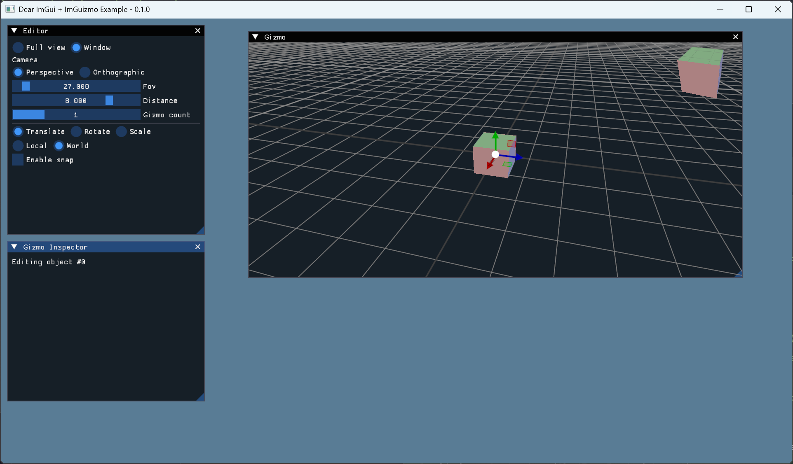

# Dear ImGuizmo - Rust Bindings

[](https://crates.io/crates/dear-imguizmo)
[](https://docs.rs/dear-imguizmo)

High-level Rust bindings for [ImGuizmo](https://github.com/CedricGuillemet/ImGuizmo), built on the C API ([cimguizmo](https://github.com/cimgui/cimguizmo)) and integrated with `dear-imgui-rs`.

This project is a Rust wrapper around the C shim (cimguizmo), not a direct C++ binding.

<p align="center">
  
  <br/>
</p>

## Links

- Upstream: https://github.com/CedricGuillemet/ImGuizmo
- C API: https://github.com/cimgui/cimguizmo

## Crate Layout

- `dear-imguizmo` (this crate): safe, idiomatic wrapper integrated with `dear-imgui-rs`.
- `dear-imguizmo-sys`: low-level FFI generated from the C API (`cimguizmo`). Prefer not using it directly unless you need raw bindings.

## Compatibility

Use Rust 1.95 or newer and keep all `dear-*` dependencies on the `0.23` release train. See the [0.23 migration notes](../../docs/COMPATIBILITY.md#023-release-train).

| Item              | Version |
|-------------------|---------|
| Crate             | 0.23.0  |
| dear-imgui-rs     | 0.23.0  |
| dear-imguizmo-sys | 0.23.0  |

### WASM (WebAssembly) support

For the experimental `wasm32-unknown-unknown` target, enable `wasm` on both direct dependencies.

```toml
[dependencies]
dear-imgui-rs = { version = "0.23", features = ["wasm"] }
dear-imguizmo = { version = "0.23", features = ["wasm"] }
```

From the matching workspace checkout, build the demo and its `imgui-sys-v1` provider with the checked-in bindings.

```bash
cargo run -p xtask -- web-demo imguizmo
cargo run -p xtask -- build-cimgui-provider
python -m http.server -d target/web-demo 8080
```

The 0.23 browser application uses `WasmProviderAllocator` and imports the provider's memory and function table. Rebuild and deploy both modules together when upgrading from 0.22. See the [tool versions and local demo](../../docs/WASM.md#local-demo) and [application setup](../../docs/WASM.md#runtime-model).

## Features

- `glam` (default): Use `glam::Mat4` seamlessly in the high-level API.
- `mint` (optional): Use `mint::ColumnMatrix4<f32>` seamlessly.
- Without those features, you can always pass `[f32; 16]` (column-major) matrices.

All matrix arguments in the API are generic over a `Mat4Like` trait, implemented for `[f32; 16]`, and when enabled, for `glam::Mat4` and `mint::ColumnMatrix4<f32>`.

## Quick Start

Use compatible stable requirements:

```toml
[dependencies]
dear-imgui-rs = "0.23"
dear-imguizmo = "0.23"
glam = "0.34"
```

Draw within a frame from an initialized platform and renderer. Keep the model and
camera matrices in application state so edits survive the next frame:

```rust
use dear_imgui_rs::Ui;
use dear_imguizmo::{Operation, Mode, GuizmoExt};
use glam::Mat4;

fn draw(ui: &Ui, model: &mut Mat4, view: &Mat4, proj: &Mat4) {
    let giz = ui.guizmo();
    giz.set_drawlist_window();
    giz.set_rect_pos_size(ui.window_pos(), ui.window_size());

    let used = giz
        .manipulate_config(view, proj, model)
        .operation(Operation::TRANSLATE)
        .mode(Mode::Local)
        //.snap([1.0, 1.0, 1.0])
        //.bounds([min_x, min_y, min_z], [max_x, max_y, max_z])
        .build();

    if used { /* object moved */ }
}
```

Start with `examples/03-features/imguizmo_minimal.rs` for a copy-ready integration. See
`examples/03-features/imguizmo_showcase.rs` for the complete demo with camera controls, snapping,
bounds, and helpers.

### Per-frame pattern

Typical usage order within a single frame:

```rust
let giz = ui.guizmo();

// 1) Configure drawing area and destination
giz.set_drawlist_window(); // or Background/Foreground
giz.set_rect_pos_size(ui.window_pos(), ui.window_size());

// 2) Manipulate
let used = giz
    .manipulate_config(&view, &proj, &mut model)
    .operation(Operation::UNIVERSAL)
    .mode(Mode::Local)
    .build();
```

Notes:
- The first `ui.guizmo()` opens the helper window. Further handles in the same ImGui frame share its draw target, ID scopes, and interaction state. Finish that frame before starting ImGuizmo in another ImGui context.
- Consecutive frames of the same context continue drags and view interpolation. Handing ImGuizmo to another context cancels the previous interaction, including when the old context has been destroyed. Style, enablement, drawing rectangle, orthographic mode, axis options, and gizmo size remain process-global.
- Set the drawing area with `set_rect(...)`. Use `set_drawlist_window()` to draw while the selected window is current, or select a viewport layer with `DrawListTarget::Background` or `DrawListTarget::Foreground`. Each frame starts on the helper window. A named alternative hover window is resolved by ID on subsequent frames of the same context.
- Keep `let _id = giz.push_id(i);` alive while drawing the corresponding gizmo. An early outer drop preserves active inner IDs. The next frame starts at the root ID.
- Style access: `let mut st = giz.style(); st.set_color(Color::Selection, [1.0,0.2,0.2,1.0]);`.
  More fields: `translation_line_arrow_size()`, `rotation_outer_line_thickness()`,
  `scale_line_circle_size()`, `hatched_axis_line_thickness()`, etc.
 - `view_manipulate`/`view_manipulate_with_camera` accept any `Into<[f32;2]>` for position/size; `set_rect_pos_size` is available as a convenience.
 - Matrices are column-major; `Mat4Like` supports `[f32;16]`, and (with features) `glam::Mat4`, `mint::ColumnMatrix4<f32>`.

Builder extras:
- `.drawlist(DrawListTarget::...)`, `.rect(x,y,w,h)`, `.orthographic(bool)`, `.gizmo_size_clip_space(f32)`
- `.axis_mask(AxisMask::X | AxisMask::Z)`
- `.translate_snap([f32;3])`, `.rotate_snap_deg(f32)`, `.scale_snap([f32;3])` (also accepts `(f32,f32,f32)`, `glam::Vec3`, `mint::Vector3<f32>`)

### Extra helpers

Simple utility methods you may find handy:

```rust
// Hover test near a world-space position (in pixels)
// Call after manipulate has established the view and projection.
let hovered = giz.is_over_at([0.0, 0.0, 0.0], 8.0);

// Compute an ImGuizmo hashed ID from a pointer
let id_from_ptr = giz.get_id_ptr(&model as *const _);
```

### Draw helpers

```rust
// Draw a grid aligned with a model transform (size in world units)
giz.draw_grid(&view, &proj, &model, 10.0);

// Draw multiple cubes from a list of model matrices
let matrices = vec![model, other_model];
giz.draw_cubes(&view, &proj, &matrices);
```

## Notes

- This crate depends on `dear-imguizmo-sys` (C API + bindgen). Linking to the base ImGui static library is provided by `dear-imgui-sys`; you do not need to configure it here.

### Graph Editor (pure Rust, optional)

We provide a minimal, pure-Rust graph editor aligned with dear-imgui style, under `dear_imguizmo::graph`. It aims to mirror ImGuizmo's GraphEditor UX without relying on the C++ API.

```rust
use dear_imguizmo::graph::{Graph, GraphView};
use dear_imguizmo::graph::GraphEditorExt; // Ui extension

let mut graph = Graph::new();
let mut view = GraphView::default();
// populate graph.nodes/links ...

ui.window("Graph")
  .size([600.0, 400.0], dear_imgui_rs::Condition::FirstUseEver)
  .build(|| {
      // Simple draw with defaults
      let _resp = ui.graph_editor().draw(&mut graph, &mut view);

      // Or configure style via builder
      let _resp = ui
          .graph_editor_config()
          .graph(&mut graph)
          .view(&mut view)
          .grid_visible(true)
          .grid_spacing(28.0)
          .link_thickness(2.0)
          .build();
  });
```

Current features:
- Grid (toggle visibility, custom spacing/color)
- Panning (MMB), node dragging (LMB)
- Selection (click, Ctrl multi-select, box select)
- Link creation (drag from output to input), link selection
- Link reconnection (drag near a link endpoint onto another pin)
- Deletion via Delete key or helper `delete_selected(&mut Graph, &mut GraphView)`
- Fit helpers: `fit_all_nodes(...)`, `fit_selected_nodes(...)`

Notes:
- Pin hover, node/link hover outlines are shown using `GraphStyle` colors.
- Simple 2D interop: `graph::Vec2Like` supports `(f32,f32)`, `[f32;2]`, `mint::Vector2<f32>`, and (with `glam`) `glam::Vec2`.
- This module is pure Rust and independent of the C++ GraphEditor; improvements are welcome.
