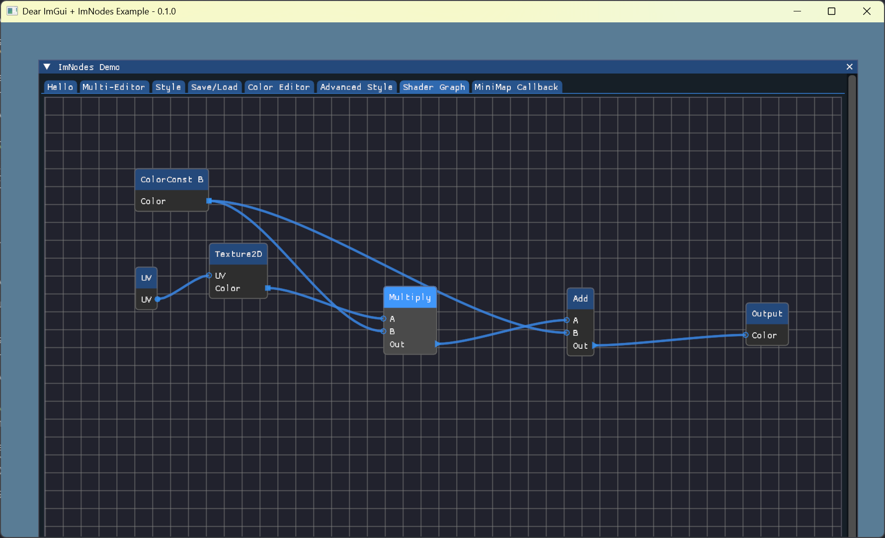

# dear-imnodes

[](https://crates.io/crates/dear-imnodes)
[](https://docs.rs/dear-imnodes)

Safe, idiomatic Rust bindings for [ImNodes](https://github.com/Nelarius/imnodes) via the [cimnodes](https://github.com/cimgui/cimnodes) C API, aligned with our dear-imgui workspace and BEST_PRACTICES.

- `ui.imnodes(&ctx)` provides access to ImNodes during a Dear ImGui frame.
- Each `Context` owns a default editor and can create independent `EditorContext` instances.
- Configure a `NodeEditorSetup`, draw nodes and attributes in closures, and read interactions from `PostEditor`.
- Scoped style tokens restore colors, style variables, and attribute flags.

<p align="center">
  
  <br/>
</p>

## Links

- Upstream: https://github.com/Nelarius/imnodes
- C API: https://github.com/cimgui/cimnodes

## Compatibility

The `0.22` release train requires Rust 1.95 or newer. Upgrade all workspace crates together. See the [0.22 migration notes](../../docs/COMPATIBILITY.md#022-release-train).

| Item              | Version |
|-------------------|---------|
| Crate             | 0.22.0  |
| dear-imgui-rs     | 0.22.0  |
| dear-imnodes-sys  | 0.22.0  |

See also: [docs/COMPATIBILITY.md](https://github.com/Latias94/dear-imgui-rs/blob/main/docs/COMPATIBILITY.md) for the full workspace matrix.

## Quick Start

Create the ImNodes context and editor once. Call `draw` inside the window that hosts the graph.

```rust
use dear_imgui_rs::Ui;
use dear_imnodes::{Context, EditorContext, ImNodesExt, LinkId, MiniMapLocation, NodeId, PinId, PinShape};

fn init(imgui: &dear_imgui_rs::Context) -> (Context, EditorContext) {
    let nodes = Context::create(imgui);
    let graph = nodes.create_editor_context();
    (nodes, graph)
}

fn draw(ui: &Ui, nodes: &Context, graph: &EditorContext, first_frame: bool) {
    let source = NodeId::new(1);
    let target = NodeId::new(2);
    let output = PinId::new(10);
    let input = PinId::new(20);
    let setup = ui.imnodes_editor(nodes, Some(graph));
    if first_frame {
        setup.set_node_pos_grid(source, [40.0, 60.0]);
        setup.set_node_pos_grid(target, [260.0, 100.0]);
    }
    let post = setup.with_nodes(|editor| {
        editor.node(source, |node| {
            node.title_bar(|| ui.text("Source"));
            node.output_attr(output, PinShape::QuadFilled, || ui.text("Out"));
        });
        editor.node(target, |node| {
            node.title_bar(|| ui.text("Target"));
            node.input_attr(input, PinShape::CircleFilled, || ui.text("In"));
        });
        editor.link(LinkId::new(100), output, input);
        editor.minimap(0.25, MiniMapLocation::TopRight);
    });
    for id in post.minimap_hovered_nodes() {
        ui.text(format!("Minimap node {id}"));
    }
}
```

### Migrating editor scopes

Replace `setup.begin_nodes()` and `editor.end()` with `let post = setup.with_nodes(|editor| { ... });`. Put each node's contents inside `editor.node(id, |node| { ... })`. Use `node.title_bar(|| ...)`, `node.input_attr(id, shape, || ...)`, `node.output_attr(id, shape, || ...)`, and `node.static_attr(id, || ...)`. The closure owns the matching native `End`, including during panic unwinding. Use `setup.end()` when you intend to submit an empty graph.

Each drawing handle belongs to its current node or editor canvas. Render a nested window inside the closure and return to the canvas before submitting another node. Call `editor.minimap()` after submitting the nodes and links. Replace `minimap_with_callback` with `post.minimap_hovered_nodes()` to handle all hovered IDs in native draw order after the minimap window closes.

### IO and interaction

Configure persistent input and style settings before drawing. Node position, drag, and snap requests take effect on submission of the matching node.

```rust
setup.enable_link_detach_with_ctrl();
setup.enable_multiple_select_with_shift();
setup.emulate_three_button_mouse_with_alt();
setup.set_alt_mouse_button(dear_imgui_rs::MouseButton::Right);
setup.set_auto_panning_speed(200.0);
```

### Styling

```rust
use dear_imnodes::{ColorElement, StyleVar};

setup.style_colors_dark();
setup.set_grid_spacing(32.0);
let post = setup.with_nodes(|editor| {
    let _color = editor.push_color(ColorElement::TitleBar, [0.9, 0.3, 0.3, 1.0]);
    let _padding = editor.push_style_var_vec2(StyleVar::NodePadding, [6.0, 4.0]);
    editor.node(node_id, |node| node.title_bar(|| ui.text("Styled")));
});
```

### Selection and link lifecycle

`PostEditor` captures hover and link events for its submission. Selection and panning operate on the bound editor. ID-specific operations return `false` if the object is absent from the captured or latest submission.

```rust
let selected_nodes = post.selected_nodes();
let selected_links = post.selected_links();
let centered = post.center_on_submitted_node(node_id);
if let Some(link) = post.is_link_created_with_nodes() {
    // Add link.start_attr and link.end_attr to the application's graph.
}
if let Some(id) = post.is_link_destroyed() {
    // Remove this link from the application's graph.
}
```

### Saving and loading editor state

`NodeEditorSetup`, `PostEditor`, and `BoundEditor` retain an explicit editor until the last handle is released. A `BoundEditor` can be kept across frames. Use it for panning and persistence while the ImNodes context is outside a drawing closure.

```rust
let bound = nodes.bind_editor(graph);
let ini = bound.save_state_to_ini_string();
bound.load_state_from_ini_string(&ini);
```

The string methods work on every target. Native callers can also use `save_state_to_ini_file` and `load_state_from_ini_file`. On `wasm32`, store the INI string through the application's browser storage.
