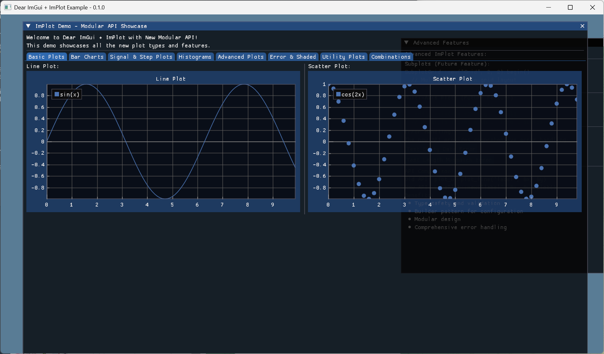

# Dear ImPlot - Rust Bindings

[](https://crates.io/crates/dear-implot)
[](https://docs.rs/dear-implot)

High-level Rust bindings for ImPlot, the immediate mode plotting library. This crate provides safe, idiomatic Rust bindings designed to work seamlessly with `dear-imgui-rs` (which uses cimgui C API) and `dear-implot-sys` (which uses cimplot C API).

For native source builds and matching prebuilt archives, see the [sys crate build modes](../dear-implot-sys/README.md#build-modes).

<p align="center">
  
  <br/>
</p>

## Links

- Upstream: https://github.com/epezent/implot
- C API: https://github.com/cimgui/cimplot

## Compatibility

Use Rust 1.95 or newer and keep all `dear-*` dependencies on the `0.23` release train. See the [0.23 migration notes](../../docs/COMPATIBILITY.md#023-release-train).

| Item              | Version |
|-------------------|---------|
| Crate             | 0.23.0  |
| dear-imgui-rs     | 0.23.0  |
| dear-implot-sys   | 0.23.0  |

### WASM (WebAssembly) support

For the experimental `wasm32-unknown-unknown` target, enable `wasm` on both direct dependencies.

```toml
[dependencies]
dear-imgui-rs = { version = "0.23", features = ["wasm"] }
dear-implot = { version = "0.23", features = ["wasm"] }
```

From the matching workspace checkout, build the demo and its `imgui-sys-v1` provider with the checked-in bindings.

```bash
cargo run -p xtask -- web-demo implot
cargo run -p xtask -- build-cimgui-provider
python -m http.server -d target/web-demo 8080
```

The 0.23 browser application uses `WasmProviderAllocator` and imports the provider's memory and function table. Rebuild and deploy both modules together when upgrading from 0.22. See the [tool versions and local demo](../../docs/WASM.md#local-demo) and [application setup](../../docs/WASM.md#runtime-model).

## Integration Quickstart

This crate integrates with `dear-imgui-rs` directly — add both crates, then build plots inside an ImGui window using a `PlotContext` bound to the current ImGui context.

Use compatible stable requirements:

```toml
[dependencies]
dear-imgui-rs = "0.23"
dear-implot = "0.23"
```

```rust
use dear_imgui_rs as imgui;
use dear_implot::*;

fn main() {
    let mut ctx = imgui::Context::create();
    ctx.io_mut().set_display_size([800.0, 600.0]);
    ctx.io_mut().set_delta_time(1.0 / 60.0);
    ctx.font_atlas().try_claim_legacy_renderer()
        .expect("CPU-only example requires the legacy atlas").build();
    let plot_ctx = PlotContext::create(&ctx);

    // Build one CPU-only frame without a platform or GPU renderer.
    let ui = ctx.frame();
    ui.window("Plot Example").build(|| {
        ui.implot(&plot_ctx).with_plot("Line", |plot| {
            let x = [0.0, 1.0, 2.0, 3.0];
            let y = [0.0, 1.0, 4.0, 9.0];
            LinePlot::new("y=x^2", &x, &y).plot(plot);
        });
    });
    drop(ctx.render_legacy());
}
```

This backend-free sample builds CPU draw data only. A visible application needs
a platform backend and renderer; use `implot_minimal` below for that integration.
Managed renderers must consume their normal frame/texture protocol instead of
this CPU-only legacy path.

Notes:
- Base ImGui static library linking is handled by `dear-imgui-sys`; you do not need to link it here.
- Refer to the `-sys` README for `IMPLOT_SYS_*` env vars when using prebuilt libraries.

### Plot scopes and axis links

`PlotUi::with_plot(title, draw)` and `with_plot_size(title, size, draw)` supply a
`&PlotScope` to item builders, coordinate queries and drawing methods. Use
`with_plot_setup(title, size, setup, draw)` to configure axes or the legend.
Setup finishes before drawing starts. Each closure runs in the window and
selected table cell that began the plot. A skipped plot returns `None`.

`SubplotGrid::build` supplies the `PlotUi` for its cells. `MultiAxisPlot::build`
passes a configured `PlotScope`. Use `with_plot_clip_rect` for clipped drawing
and `LegendManager::with_popup` for a legend entry's ImGui controls. Context
styles also use closures, such as `plot_ui.with_colormap(map, || { ... })`.

Set next-plot limits on `PlotUi` before opening a plot. Use
`PlotSetup::setup_axis_links` inside `with_plot_setup` to share a range between
plots. Create the `Cell<f64>` values outside the setup closure so they live
until the plot ends, including on unwind. ImPlot does not borrow these cells
directly. Setup reads their values and the wrapper writes back the final valid
limits after `EndPlot`. Non-finite values are ignored. An invalid range leaves
the current limits unchanged.

```rust,no_run
use dear_implot::{Axis, PlotUi};
use std::cell::Cell;

fn draw_linked_plots(plots: &PlotUi<'_>) {
    let min = Cell::new(0.0);
    let max = Cell::new(1.0);
    for title in ["First", "Second"] {
        plots.with_plot_setup(
            title,
            [240.0, 180.0],
            |setup| setup.setup_axis_links(Axis::X1, Some(&min), Some(&max)),
            |plot| plot.plot_line("series", &[0.0, 1.0], &[0.0, 1.0]),
        );
    }
}
```

Axis limits must be increasing and have a finite width. Use
`AxisFlags::INVERT` to reverse the display direction.

### Validated numeric formats

ImPlot value labels use validated `FloatFormat` values instead of arbitrary C
format strings. Axis formats additionally use `AxisFormat`, which enforces
ImPlot's fixed 15-byte storage limit. These formats must be ASCII because
ImPlot forwards the complete string to locale-sensitive native formatting
paths. Explicit tick labels accept UTF-8 and are copied during setup. Custom
formatter and transform callbacks run inside ImPlot and must not reenter ImGui
or ImPlot. Their unsafe registration methods keep them alive through native
writeback and detach them before dropping the Rust closures.

```rust
let value_format = FloatFormat::new("%.2f ms")?;
let axis_format = AxisFormat::new("%.1f")?;
```

## Features

- **Safe, idiomatic Rust API** - Memory-safe interfaces with proper lifetime management
- **Full compatibility with dear-imgui** - Uses the same context management patterns
- **Builder pattern for plots** - Fluent, ergonomic API for creating plots
- **Comprehensive plot types** - Support for all major plot types including:
  - Line plots and scatter plots
  - Bar charts and histograms (1D and 2D)
  - Heatmaps and pie charts
  - Error bars and shaded plots
  - Stem plots and more
- **Advanced features** - Subplots, multi-axis plots, and legend management
- **Modular design** - Each plot type is in its own module for better organization
- **Universal plot builder** - Unified API for creating any plot type

## Quick Start

Add to your `Cargo.toml`:

```toml
[dependencies]
dear-imgui-rs = "0.23"
dear-implot = "0.23"
```

Basic usage:

```rust
use dear_imgui_rs::*;
use dear_implot::*;

fn main() -> Result<(), Box<dyn std::error::Error>> {
    let mut ctx = Context::create();
    ctx.io_mut().set_display_size([800.0, 600.0]);
    ctx.io_mut().set_delta_time(1.0 / 60.0);
    ctx.font_atlas().try_claim_legacy_renderer()
        .expect("CPU-only example requires the legacy atlas").build();
    let plot_ctx = PlotContext::create(&ctx);

    // One CPU-only frame; use a renderer-driven loop in a visible application.
    let ui = ctx.frame();
    ui.window("My Plots")
        .size([800.0, 600.0], Condition::FirstUseEver)
        .build(|| {
            ui.implot(&plot_ctx).with_plot("Line Plot", |plot| {
                let x_data = [0.0, 1.0, 2.0, 3.0, 4.0];
                let y_data = [0.0, 1.0, 4.0, 9.0, 16.0];

                // New modular API
                LinePlot::new("Quadratic", &x_data, &y_data).plot(plot);
            });
        });
    drop(ctx.render_legacy());
    Ok(())
}
```

The following plot snippets assume an initialized renderer-driven frame, an
active plot, and application-owned input arrays. They illustrate API calls;
`implot_minimal` and `implot_showcase` are complete runnable applications.

## Plot Types

The following item examples use the `plot` argument of a drawing closure.

### Line and Scatter Plots

```rust
// Line plot
LinePlot::new("My Line", &x_data, &y_data).plot(plot);

// Scatter plot
ScatterPlot::new("My Points", &x_data, &y_data).plot(plot);

// Item styling via ImPlotSpec-backed builder helpers
LinePlot::new("Styled Line", &x_data, &y_data)
    .with_line_color([0.20, 0.70, 1.00, 0.35]) // alpha comes from the color itself
    .with_line_weight(2.0)
    .with_marker(Marker::Circle)
    .with_marker_size(6.0)
    .with_marker_fill_color([0.20, 0.70, 1.00, 0.85])
    .plot(plot);

// The same styling helpers are available on other ImPlotSpec-backed builders
BarPlot::new("Styled Bars", &values)
    .with_fill_color([0.90, 0.45, 0.20, 0.80])
    .with_line_color([0.45, 0.15, 0.05, 1.00])
    .with_line_weight(1.5)
    .plot(plot);
```

### Bar Charts

```rust
// Simple bar chart
BarPlot::new("Bars", &values)
    .with_bar_size(0.8)
    .plot(plot);

// Positional bar chart
PositionalBarPlot::new("Positioned Bars", &x_positions, &values)
    .with_bar_size(0.5)
    .plot(plot);
```

### Histograms

```rust
// 1D Histogram
HistogramPlot::new("Distribution", &data)
    .with_bins(20usize)
    .density()
    .cumulative()
    .plot(plot);

// Automatic binning method
HistogramPlot::new("Auto Distribution", &data)
    .with_bins(BinMethod::Scott)
    .plot(plot);

// 2D Histogram
Histogram2DPlot::new("2D Distribution", &x_data, &y_data)
    .with_bins(10usize, 10usize)
    .plot(plot);
```

### Heatmaps

```rust
let data: Vec<f64> = (0..100).map(|i| (i as f64 * 0.1).sin()).collect();

HeatmapPlot::new("Heat", &data, 10, 10)
    .with_scale(-1.0, 1.0)
    .with_bounds(0.0, 0.0, 1.0, 1.0)
    .try_label_format("%.2f")
    .expect("static numeric format is valid")
    .plot(plot);
```

### Pie Charts

```rust
let labels = vec!["A", "B", "C", "D"];
let values = [0.25, 0.35, 0.20, 0.20];

PieChartPlot::new(labels, &values, 0.5, 0.5, 0.4)
    .normalize()
    .exploding()
    .with_start_angle(90.0)
    .plot(plot);
```

### Error Bars

```rust
let errors = [0.1, 0.2, 0.15, 0.3, 0.25];

ErrorBarsPlot::new("Measurements", &x_data, &y_data, &errors)
    .horizontal()
    .plot(plot);
```

### Shaded Plots

```rust
// Shaded area plot
ShadedPlot::new("Area", &x_data, &y_data)
    .with_y_ref(0.0)
    .plot(plot);

// Shaded between two curves
ShadedBetweenPlot::new("Between", &x_data, &y1_data, &y2_data)
    .plot(plot);
```

## Advanced Features

### Subplots

```rust
SubplotGrid::new("My Subplots", 1, 2)
    .with_size([800.0, 300.0])
    .build(&plot_ui, |grid| {
        grid.with_plot("", |plot| LinePlot::new("Line", &x_data, &y_data).plot(plot));
        grid.with_plot("", |plot| BarPlot::new("Bars", &values).plot(plot));
    })?;
```

### Multi-Axis Plots

```rust
let multi_plot = MultiAxisPlot::new("Multi-Axis")
    .add_y_axis(YAxisConfig {
        label: Some("Temperature (°C)"),
        flags: AxisFlags::NONE,
        range: Some((-10.0, 40.0)),
    })
    .add_y_axis(YAxisConfig {
        label: Some("Pressure (hPa)"),
        flags: AxisFlags::NONE,
        range: Some((900.0, 1100.0)),
    });

multi_plot.build(&plot_ui, |plot| {
    plot.set_axes(XAxis::X1, YAxis::Y1);
    LinePlot::new("Temperature", &time, &temp).plot(plot);
    plot.set_axes(XAxis::X1, YAxis::Y2);
    LinePlot::new("Pressure", &time, &pressure).plot(plot);
})?;
```

### Axis Setup & Selection

```rust
plot_ui.with_plot_setup("Measurements", [-1.0, 0.0], |setup| {
    setup.setup_axes(Some("Time (s)"), Some("Value"), AxisFlags::NO_GRID_LINES, AxisFlags::NONE);
    setup.setup_x_axis_ticks_positions(XAxis::X1, &[0.0, 1.0, 2.0], Some(&["0s", "1s", "2s"]), true);
    setup.setup_y_axis_scale(YAxis::Y1, AxisScale::SymLog);
    setup.setup_y_axis_format(YAxis::Y1, &AxisFormat::new("%.2f").unwrap());
    setup.setup_axes_limits(0.0, 3.0, -1.0, 1.0, PlotCond::Once);
}, |plot| {
    LinePlot::new("Values", &time, &values).plot(plot);
    if let Some(rect) = plot.plot_selection_axes(XAxis::X1, YAxis::Y1) {
        // Use rect.X and rect.Y to inspect the selection.
    }
});
```

### Infinite Lines & Image

```rust
// Infinite lines
plot.inf_lines_vertical("vlines", &[1.0, 2.0, 3.0])?;
plot.inf_lines_horizontal("hlines", &[0.0])?;

// Pass the frame's borrowed atlas texture directly to the plot.
if let Some(atlas) = ui.font_atlas_texture() {
    let bounds_min = ImPlotPoint { x: 0.0, y: 0.0 };
    let bounds_max = ImPlotPoint { x: 1.0, y: 1.0 };
    plot.plot_image("Font atlas", atlas, bounds_min, bounds_max)?;
}
```

### Universal Plot Builder

For a unified fallible API, use `PlotBuilder`:

```rust
// Line plot
PlotBuilder::line("My Line", &x_data, &y_data).build(plot)?;

// Bar plot
PlotBuilder::bar("My Bars", &values).build(plot)?;

// Histogram
PlotBuilder::histogram("Distribution", &data).build(plot)?;

// Heatmap
PlotBuilder::heatmap("Heat", &data, 10, 10).build(plot)?;
```

## Error Handling

`PlotBuilder::build` and the fallible `PlotScope` helpers return `Result<(), PlotError>`.
The `Plot::plot` trait method returns `()` and skips invalid data; call `validate()`
first when the application needs an error:

```rust
match LinePlot::new("My Plot", &x_data, &y_data).validate() {
    Ok(_) => {
        // Plot is valid, proceed
        LinePlot::new("My Plot", &x_data, &y_data).plot(plot);
    }
    Err(PlotError::DataLengthMismatch { x_len, y_len }) => {
        eprintln!("Data length mismatch: x = {}, y = {}", x_len, y_len);
    }
    Err(PlotError::EmptyData) => {
        eprintln!("Cannot plot empty data");
    }
    Err(e) => {
        eprintln!("Plot error: {}", e);
    }
}
```

## Integration with Dear ImGui

This crate is designed to work seamlessly with the dear-imgui ecosystem:

- Uses the same context management patterns as dear-imgui
- Compatible with dear-imgui's UI tokens and lifetime management
- Shares the same underlying Dear ImGui context
- Follows the same safety and ergonomics principles

## Examples

See the `examples/` directory for complete working examples:

- `examples/03-features/implot_minimal.rs` - Minimal plot integration.
- `examples/03-features/implot_showcase.rs` - Plot gallery, subplots, and dynamic data.

```text
cargo run -p dear-imgui-examples --bin implot_minimal --features implot
cargo run -p dear-imgui-examples --bin implot_showcase --features implot
```

## Building

This crate requires:

- Rust 1.95 or later (the workspace minimum).
- A C++17 compiler for default native source builds.
- Initialized recursive submodules when building from a Git checkout.

CMake is optional: `IMPLOT_SYS_USE_CMAKE` requests its alternate source route,
which can fall back to the maintained `cc` route when an upstream wrapper needs
a repository patch. Ordinary builds use validated checked-in Rust bindings and
do not require libclang. Explicit regeneration requires `bindgen` and libclang.

The build process automatically handles:

- Compiling the pinned ImPlot and cimplot sources.
- Validating checked-in binding provenance.
- Linking to the shared Dear ImGui core supplied by `dear-imgui-sys`.

## Architecture

This crate follows the same architectural patterns as `dear-imgui-rs`:

- **Context Management**: Separate ImPlot context that works alongside Dear ImGui
- Setup and drawing closures borrow the active plot until its native `EndPlot`.
- **RAII**: Automatic cleanup of resources and style stacks
- **Builder Patterns**: Fluent APIs for configuration
- **Modular Design**: Each plot type is in its own module

## License

The Rust crate is licensed under MIT OR Apache-2.0, matching the workspace.
The pinned ImPlot/cimplot sources retain their upstream license notices.

## Contributing

Contributions are welcome! Please feel free to submit a Pull Request.
